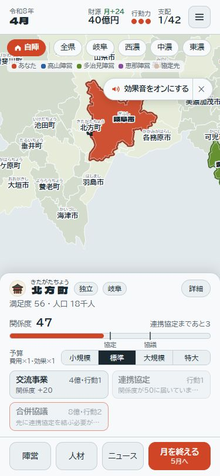
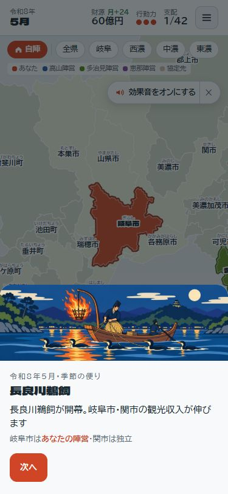

# ゲームの追加確認

確認日：2026年10月16日。手元の対象は **ver. 0.1.7**。依頼された順に、スマホ、人口、偉人、特産・季節、保存・中断を確認した。今回は確認資料だけを追加し、ゲームは修正していない。

## 主な結果

| 項目 | 結果 | 次の対応 |
| --- | --- | --- |
| スマホ | 横はみ出し・詳細の開閉は問題なし。小さい操作対象がある | 圏域ボタンとメニューを44px以上に。小さな町を一覧から選べるようにする |
| 人口 | 41市町村は2020年国勢調査の丸め値と一致。七宗町だけ丸め方が合わない | 人口の基準日を明記し、七宗町を見直す |
| 偉人 | 14人とも市町村との関連を確認 | 「ゆかり」を維持。出自の諸説と創作のセリフの扱いを明確にする |
| 特産・季節 | 関市の鵜飼の説明に対応する季節効果がない | 刃物と鵜飼の両方を扱えるようにする |
| 保存・中断 | 通常の再開と旧版の移行は通過。例外時の扱いに問題あり | 保存失敗の通知と、読み込むデータの検証を追加する |

先に直したいのは、保存失敗の通知、不完全なセーブからの復旧、関市の鵜飼の効果、小さい操作対象の4点。以下では、再現できた問題と、仕様として判断したい点を分けている。

## 1. スマホの表示・操作

### 対象と制限

[公開先](https://rioriu.github.io/gifu-toitsu-senki/)を375×812pxで実際に操作した。公開先の表示は **ver. 0.1.4**。手元のver. 0.1.7とは区別する。前回修正した飛び地の名前やアイコンは、今回の公開画面では確認していない。

今回測った圏域ボタン・メニューボタンのCSSは手元でも同じ。公開版から手元までのCSS差分は、人材解雇の表示に関するものだった。

### 確認できたこと

- タイトル、岐阜市の詳細、ゲーム開始、北方町の選択、詳細の開閉を確認した。
- ページ全体の横はみ出しはなかった。
- 北方町を選択後も、地図と操作欄を表示できた。
- 下の「陣営」「人材」「ニュース」「月を終える」は高さ約48pxだった。

### 改善したいこと

- **圏域ボタンの高さは約29px、メニューは38×38px**。仕様書のボタン最小44pxに届かない。`css/style.css:77` と `:105`。374px以下ではメニューを34pxに縮める指定もある。
- 初期の地図で、北方町の領域の外接矩形は約12×26px、岐南町は約32×21px、笠松町は約52×27pxだった。これは外接矩形なので、実際に押せる面積はさらに小さい。
- 小さな町には拡大が必要。仕様書にある「一覧からの選択」はタイトルの開始地点選びにはあるが、ゲーム中の「陣営」画面には42市町村の選択一覧がない。市町村一覧か、隣接する町の選択一覧を用意するとよい。

タッチ端末での複数指のピンチ、iOS Safariのアドレスバー・ノッチ・キーボードに伴う表示変化は未確認。ブラウザの幅指定による確認を、実機確認と同じものには扱わない。

## 2. 人口と基準日

### 比較方法

対象は `GameLogic.INFO` の42市町村。ゲームの人口は千人単位なので、比較時は1000倍して人にそろえた。コード・市町村名の対応、42件の網羅性、数値の正値を確認した。

仕様書にある[県の資料](https://www.pref.gifu.lg.jp/uploaded/attachment/337776.pdf)は、2020年10月1日の国勢調査を掲載している。「市町村別人口」の冊子111ページ（PDFの6ページ目）を比較元とした。白川村は100人単位、その他は1000人単位に四捨五入した値と比較すると、**41/42市町村が一致**した。

- ゲームの合計：1,980,500人。
- 2020年国勢調査の合計：1,978,742人。差は+1,758人、約+0.089％。合計の差自体は概数の丸めで説明できる範囲。
- 七宗町：ゲーム4,000人、2020年は3,402人。他の町と同じ1000人単位の四捨五入なら3,000人。現在の値は統計より約17.6％多い。

### 基準年を表示したい

ゲームは2026年4月に始まるが、人口の説明には基準年がない。現在確認できる[2026年4月1日の県推計人口](https://www.pref.gifu.lg.jp/page/495889.html)は1,877,626人で、ゲームの合計はこれより約5.48％多い。現在の一覧は2025年国勢調査確定値を基に2026年10月9日に更新されたものなので、2020年国勢調査と同じ調査時点・区分ではない。

**2020年の人口を使うこと自体を誤りとはしない。** 「人口は2020年国勢調査を丸めた概数」と明記すれば、ほぼ全件の根拠がそろう。2026年の人口へ更新するなら、42件すべてを同じ時点・同じ区分にそろえ、税収・人材の人数・難易度も再確認したい。

全42件の比較値は末尾の表と [population-comparison.json](review-2026-10-16/population-comparison.json) に残した。2026年の比較値の出典は[県の一覧](https://www.pref.gifu.lg.jp/uploaded/attachment/516061.pdf)。人口と世帯数、郡の合計を取り違えないよう、市町村の人口総数だけを採った。

## 3. 偉人とゆかりの地

現在の画面は「出身地」ではなく「○○市ゆかり」と表現している。城・活動・記念施設・地域の伝承も含む表現として妥当で、14人の設定地を変更する必要があるような取り違えは見つからなかった。

| 偉人 | 設定地 | 確認した関連・出典 |
| --- | --- | --- |
| 斎藤道三 | 山県市 | 大桑城をめぐる戦い。[山県市](https://www.city.yamagata.gifu.jp/site/oogajoato/) |
| 織田信長 | 岐阜市 | 岐阜城を拠点にした活動。[岐阜市の日本遺産紹介](https://www.city.gifu.lg.jp/kankoubunka/bunkazai/1019997/1005565.html) |
| 竹中半兵衛 | 垂井町 | 居城の菩提山城。[垂井町](https://www.town.tarui.lg.jp/page/16167.html)。出生地としての設定ではない |
| 明智光秀 | 可児市 | 明智荘・生誕地とする説。[可児市](https://www.city.kani.lg.jp/24402.htm)。出生地には諸説ある |
| 金森長近 | 高山市 | 高山城・城下町の整備。[高山市](https://www.city.takayama.lg.jp/machihaku/1005305/1020397.html) |
| 松尾芭蕉 | 大垣市 | 奥の細道むすびの地。[大垣市](https://www.city.ogaki.lg.jp/0000001000.html) |
| 古田織部 | 本巣市 | 山口地区での顕彰・織部の里もとす。[本巣市広報](https://www.city.motosu.lg.jp/cmsfiles/contents/0000002/2464/202406-3.pdf) |
| 島崎藤村 | 中津川市 | 出生地の馬籠宿。[中津川市](https://www.city.nakatsugawa.lg.jp/soshikikarasagasu/kankoka/5/2/756.html) |
| 円空 | 羽島市 | 円空仏・資料館・生誕の伝承。[羽島市](https://www.city.hashima.lg.jp/4941.html)。出生の諸説は[県図書館の村史目次](https://www.library.pref.gifu.lg.jp/gifuken-mokuji/seki/horado_tusi1.htm)でも確認できる |
| 杉原千畝 | 八百津町 | 杉原千畝記念館・人道の丘。[八百津町](https://www.town.yaotsu.lg.jp/1550.htm)。この確認では出生地の確定までは扱わない |
| 千代 | 郡上市 | 遠藤盛数の娘とする説・銅像。[郡上八幡城](https://hachiman-castle.com/history/story/)。同ページも出自の諸説を明記している |
| 徳川家康 | 関ケ原町 | 最初・最後の陣地。[県の文化財情報](https://www.pref.gifu.lg.jp/page/366371.html) |
| 石田三成 | 関ケ原町 | 陣地。[県の文化財情報](https://www.pref.gifu.lg.jp/page/366371.html) |
| 大谷吉継 | 関ケ原町 | 陣跡・墓。[県の古戦場記念館](https://sekigahara.pref.gifu.lg.jp/otani-yoshitsugu/) |

助言のセリフ `ADVISORS[].say` は引用符付きで表示されるが、史料の引用元が付いていない。実在の名言としては確認していないため、ゲーム用の創作会話である旨をガイドに添えると誤解が少ない。人物の効果・招く条件はゲーム上の設定として評価し、史実の数値とは扱わない。

## 4. 特産タグ・季節イベント

### 一致していること

- 全42市町村×12か月、504通りの `seasonX` を設定表と比較し、一致した。これは設定表どおりの実装を確認したもので、設定表そのものの歴史・観光上の妥当性を保証するものではない。
- 高山祭の4月・10月は[高山の公式観光情報](https://www.hidatakayama.or.jp/special/detail_55.html)と一致する。
- 郡上おどりの7〜9月は[県観光公式の開催期間](https://www.kankou-gifu.jp/article/detail_86.html)と整合する。
- 美濃和紙の「人材の企画+8」は、所有を切り替える実行確認で差が8になった。
- 温泉・合掌造り・美濃焼・刃物などの特定月の倍率は、観光地の営業期間そのものではなくゲーム上の繁忙期設定として扱う。
- アイコンだけに使う題材と、効果を持つ特産タグは別のデータ。全42アイコンに固有の能力が付いているわけではない。

### 修正したい：関市に鵜飼の倍率が付かない

`js/logic.js:1389` の5月の案内は「岐阜市・関市の観光収入が伸びます」。[関市の小瀬鵜飼](https://www.city.seki.lg.jp/kanko/0000001578.html)は5月11日〜10月15日で、関市を対象にすることも時期も適切。

しかし、関市の特産タグは「刃物」だけで、`seasonX` はそのタグ1つだけを見る。実行結果は岐阜市の5月が1.6倍、関市の5月・6月は1倍。関市の5〜9月には鵜飼の効果がない。10月は刃物の設定で1.6倍になるので、10月だけ比較すると見落とす。

特産を複数持てるようにするか、市町村別の季節効果を持たせるなどして、刃物の強みを保ったまま鵜飼を扱いたい。両方が重なる10月に倍率を重ねるかどうかも明示する。

### 仕様確認：最初の4月の季節イベント

新規ゲームは `turn:0` の2026年4月で始まるが、初期化で季節イベントを実行しない。`endTurn` は先に5月へ進めてからイベントを処理するため、最初の春の高山祭のログ・便りは出ない。12か月進めると翌年4月に初めて出ることを確認した。

開始時から春祭を見せたいなら初期の案内が必要。ただし、イベント関数全体をそのまま初期化で呼ぶと、災害予報やランダムな企業進出まで変わるため、祭の案内と月次の処理を分けたい。開始地点詳細にある「4月の収入」も、現在は試算であり、開始直後にその額が入金されるものではない。

## 5. セーブ・連打・決戦の中断

### 通過した確認

- 公開版で、岐阜市の4月に北方町との交流事業を実行。財源40→36億円、行動力3→2、関係度47→67になった。再読み込みして「つづきから」を選んでも、36億円・行動力2・関係度67を保持した。
- 手元のロジックでは42市町村×2モード×12か月、計1,008回のJSON保存・復元を行い、保存しない場合と状態が一致した。乱数の続きも同じだった。
- ver. 0.0.8とver. 0.1.4のコードで新規ゲームを6か月進め、その保存状態を現行の移行処理に渡して7か月目へ進められた。すべての過去の途中状態を網羅した検査ではない。
- 月末のイベント画面・相手のリプレイ・決戦中は、月を進める呼び出しが拒否された。公開版でも月末ボタンのダブルクリックで4月→5月まで進み、季節の画面を開いている間に6月へは進まなかった。
- 決戦で確定した賛成票・反対票は保存・復元でき、再開時に同じ決戦が重複しないことを確認した。
- 42市町村の実人口による決戦の地区生成を模擬実行し、地区の点が領域内にあり、道のグラフがつながり、地区の重みの合計が1になることを確認した。
- 決戦の時間制御を模擬実行し、非表示・一時停止中は時間が進まず、復帰時に非表示時間をまとめて加算しないことを確認した。これは端末実機のバックグラウンド動作を保証する検査ではない。

### 修正したい：保存失敗が利用者に伝わらない

`js/ui.js:30` の `save()` は例外を空の `catch` で無視する。容量不足を想定して `localStorage.setItem` を例外にしたところ、保存できず、戻り値も通知もなかった。メニューでは自動保存されると説明されるため、利用者は保存できていると思ったまま進めてしまう。

保存の成否を返し、失敗時には「このブラウザに保存できていません」と通知したい。直前の正常な保存を壊さず、復旧手段も案内できるとよい。

### 修正したい：形式が正しい不完全なセーブで起動が止まる

`loadSaved()` はJSONの構文だけを確認する。保存キー `gifu-toitsu-v1` が `{}` や `123` の場合、読み込みは成功するが、`showTitle()` で `saved.factions[0]` を参照して例外になった。逆に、`{` のようにJSON自体が壊れている場合は、既存の例外処理でタイトルを開けた。

`ver`、`turn`、`factions`、42件の市町村、必須の数値など、受け付ける状態の形を検証したい。利用者の保存データを無断で消すのではなく、復旧・バックアップを選べる形が望ましい。

### 仕様として判断したいこと

- 決戦の途中の盤面・残り時間は保存していない。再読み込みすると月の途中の状態から決戦をやり直す。確定済みの結果が保存されることとは区別する。完全な中断再開を対応範囲に入れるか、説明を添えるかを決めたい。
- リプレイ・季節の案内・決戦などがないときは、月末ボタンを2回呼べば2か月進む。二重実行の競合ではなく、通常の処理が2回完了する。連打による誤操作を防ぐなら、短い待ち時間や押した状態の制御を検討する。

## 確認の範囲

数値の変更による勝率の再測定、すべてのイベントの画面、iOS・Androidの実機差、あらゆる旧版のセーブと破損状態は網羅していない。主な実行結果は [checks.json](review-2026-10-16/checks.json) に残した。今回ゲームを変更していないため、版はver. 0.1.7のまま。

## 全市町村の人口比較

人数は人単位。2026年の値はゲーム開始日に合わせた比較であり、2020年の国勢調査と同じ統計の列ではない。修正の採否を決める前に基準日を選ぶこと。

| 市町村 | ゲーム | 2020年国勢調査 | 2026年4月推計 | 2020年の丸めとの一致 |
| --- | ---: | ---: | ---: | --- |
| 岐阜市 | 403,000 | 402,557 | 387,299 | 一致 |
| 大垣市 | 158,000 | 158,286 | 153,755 | 一致 |
| 高山市 | 84,000 | 84,419 | 78,379 | 一致 |
| 多治見市 | 107,000 | 106,732 | 100,478 | 一致 |
| 関市 | 85,000 | 85,283 | 80,296 | 一致 |
| 中津川市 | 77,000 | 76,570 | 70,280 | 一致 |
| 美濃市 | 19,000 | 19,247 | 17,441 | 一致 |
| 瑞浪市 | 37,000 | 37,150 | 34,758 | 一致 |
| 羽島市 | 66,000 | 65,649 | 64,020 | 一致 |
| 恵那市 | 48,000 | 47,774 | 43,318 | 一致 |
| 美濃加茂市 | 57,000 | 56,689 | 56,624 | 一致 |
| 土岐市 | 55,000 | 55,348 | 50,633 | 一致 |
| 各務原市 | 145,000 | 144,521 | 140,458 | 一致 |
| 可児市 | 100,000 | 99,968 | 96,912 | 一致 |
| 山県市 | 25,000 | 25,280 | 23,083 | 一致 |
| 瑞穂市 | 56,000 | 56,388 | 56,510 | 一致 |
| 飛騨市 | 23,000 | 22,538 | 20,172 | 一致 |
| 本巣市 | 33,000 | 32,928 | 31,593 | 一致 |
| 郡上市 | 39,000 | 38,997 | 34,997 | 一致 |
| 下呂市 | 30,000 | 30,428 | 26,929 | 一致 |
| 海津市 | 33,000 | 32,735 | 29,589 | 一致 |
| 岐南町 | 26,000 | 25,881 | 26,100 | 一致 |
| 笠松町 | 22,000 | 22,208 | 21,730 | 一致 |
| 養老町 | 27,000 | 26,882 | 24,011 | 一致 |
| 垂井町 | 26,000 | 26,402 | 24,733 | 一致 |
| 関ケ原町 | 7,000 | 6,610 | 5,696 | 一致 |
| 神戸町 | 19,000 | 18,585 | 17,405 | 一致 |
| 輪之内町 | 10,000 | 9,654 | 8,841 | 一致 |
| 安八町 | 14,000 | 14,355 | 13,849 | 一致 |
| 揖斐川町 | 20,000 | 19,529 | 17,094 | 一致 |
| 大野町 | 22,000 | 22,041 | 20,316 | 一致 |
| 池田町 | 23,000 | 23,360 | 21,335 | 一致 |
| 北方町 | 18,000 | 18,139 | 18,325 | 一致 |
| 坂祝町 | 8,000 | 8,071 | 7,963 | 一致 |
| 富加町 | 6,000 | 5,626 | 5,733 | 一致 |
| 川辺町 | 10,000 | 9,860 | 9,157 | 一致 |
| 七宗町 | 4,000 | 3,402 | 2,811 | 不一致 |
| 八百津町 | 10,000 | 10,195 | 9,128 | 一致 |
| 白川町 | 7,000 | 7,412 | 6,304 | 一致 |
| 東白川村 | 2,000 | 2,016 | 1,754 | 一致 |
| 御嵩町 | 18,000 | 17,516 | 16,362 | 一致 |
| 白川村 | 1,500 | 1,511 | 1,455 | 一致 |
